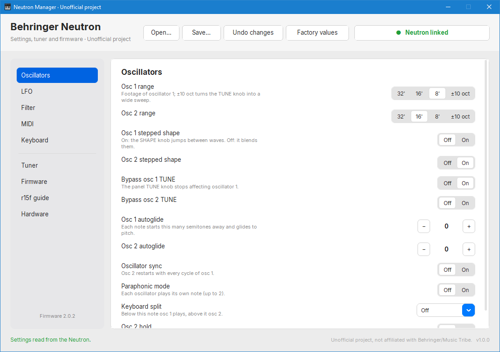
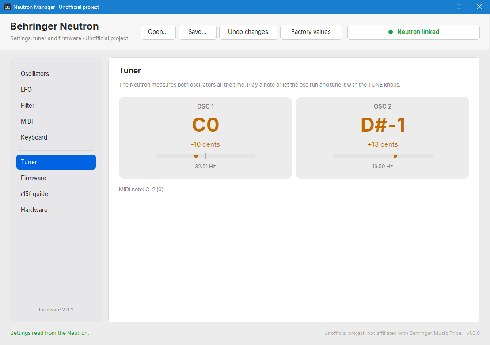

# Neutron Manager (unofficial)

A Windows tool for the **Behringer Neutron**: global settings editor, live tuner, safe firmware backup and
install (including the alternative firmware **r15f** by mrf-r), and a reference of r15f's panel combinations.

> [!NOTE]
> This is an unofficial project, not affiliated with or endorsed by Behringer or Music Tribe.
> The settings protocol was documented in clean-room fashion (see [SPEC.md](SPEC.md)): no code or assets
> from the official editor are included.



## Download

Get **Neutron Manager.exe** from the [latest release](https://github.com/nexushouser92/neutron-manager/releases/latest)
(Windows 10/11, no installation needed). Its SHA-256 is published next to it as `SHA256.txt`.

## Features

* **Automatic linking** over USB-MIDI: the Neutron is found as soon as it is plugged in.
* **All 37 global settings** of the factory firmware (2.0.2 or later), grouped as Oscillators, LFO, Filter,
  MIDI and Keyboard. Each change is applied a moment after your last edit and **read back to verify it**.
  Changes made on the Neutron's own panel show up in the window.
* **Live tuner** for both oscillators, from the readings the Neutron streams by itself.
* **Firmware tab** through the chip's ROM bootloader (DFU):
  * full 128 KB backup first, always;
  * erases **only the pages the new firmware uses**, never the whole chip (so data stored elsewhere,
    such as calibration, is not wiped by the install itself);
  * every write is read back and compared;
  * refuses anything that is not an STM32F072 with the Neutron's flash layout.
* **r15f guide**: every button combination of the alternative firmware, since r15f has no USB or SysEx.
* Save and open settings as JSON. Spanish and English, from the Windows language.



## Documents

| File | What it contains |
|---|---|
| [SPEC.md](SPEC.md) | The SysEx protocol, verified against a real Neutron 2.0.2 |
| [HARDWARE.md](HARDWARE.md) | What the Neutron's hardware can and cannot do |
| [FIRMWARE_ANALYSIS.md](FIRMWARE_ANALYSIS.md) | Where r15f spends its CPU (947 of 1000 cycles) and how to measure and reduce it |

## Run from source

```
python -m pip install -r requirements.txt
python main.py
```

Tests (no Neutron needed: they use a simulated Neutron and a simulated bootloader):

```
python -m unittest discover -s tests -t . -v
```

## Credits

Alternative firmware r15f and its manual: Evgeny "mrf" Chernykh, GPL-3, <https://github.com/mrf-r/Neutron>.
Firmware files are not distributed in this repository.

MIT License.
